# Hanja Trainer

[](https://github.com/euisuh/hanja-trainer/actions/workflows/ci.yml)

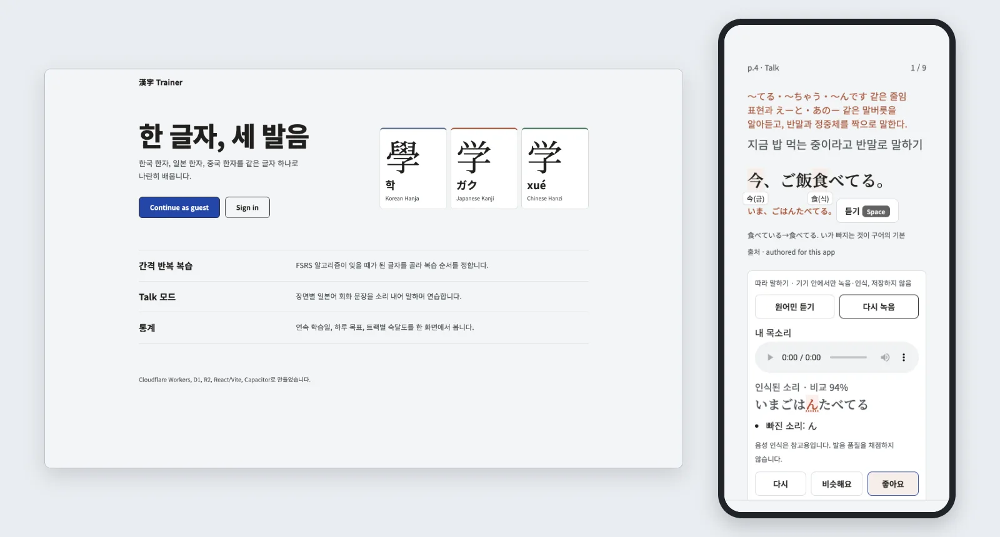

Spaced-repetition trainer for Chinese-origin characters, taught across three
tracks at once: Korean Hanja (한자능력검정), Japanese Kanji (JLPT/漢検) and
Chinese Hanzi (HSK/通用规范汉字表). The same character is shown with its shared
core meaning and its three readings, so the tracks reinforce each other. It is a
single-user, keyboard-first app (1-4 answer, Enter advance, Esc pause) that also
works on mobile. Example sentences come from real corpora and textbooks; none are
AI-generated.

Live demo: https://hanja.uiseoya.com (Continue as guest; no signup, progress kept 7 days in your browser)

## How it works

Each character appears once with its shared meaning and its Korean, Japanese
and Chinese readings. Answers feed an FSRS schedule, so the review queue holds
only cards that are due. Talk mode then moves from characters to speech: you
work through situation scenes (ordering at a cafe, asking someone to repeat),
say each line from a Korean cue, and shadow it. Talk sentences are
Tatoeba-sourced; a small number of staff lines are authored for this app and
labeled "authored for this app" on the card. Speech feedback runs in the
browser (local recording, browser-provided recognition); the app stores no audio
or transcript. It compares what was heard with the line and does not score
pronunciation.

## Screenshots

Captured from a local build through the guest flow with
`scripts/capture-readme-screenshots.mjs`. The app UI is in Korean. The study
history on the stats screen is seeded fixture data, not real usage.

<table>
  <tr>
    <td>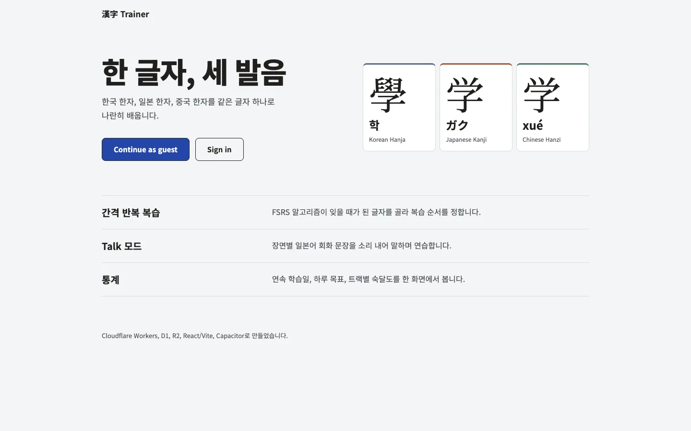</td>
    <td>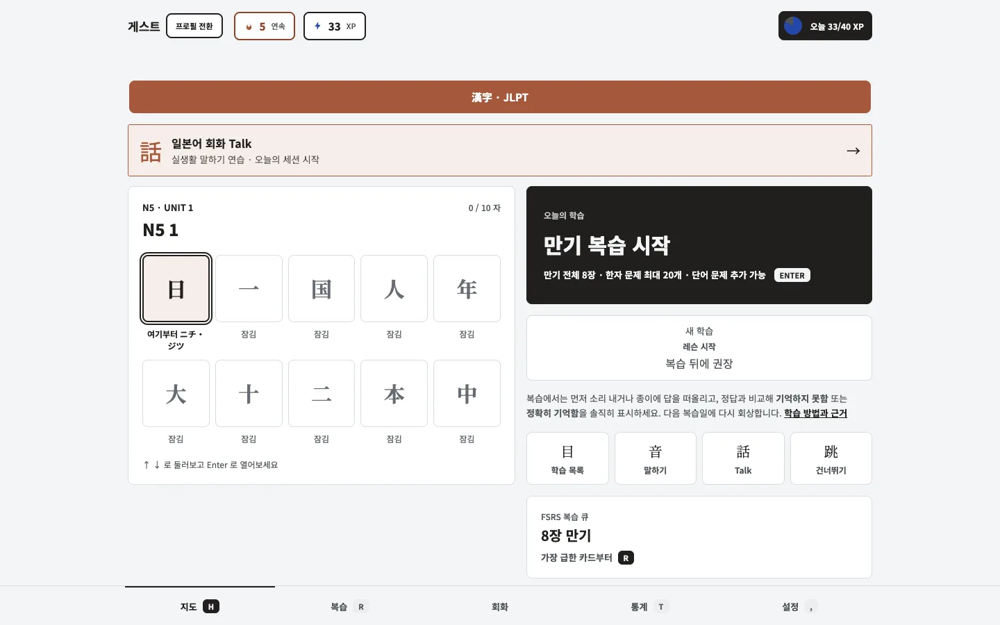</td>
  </tr>
  <tr>
    <td>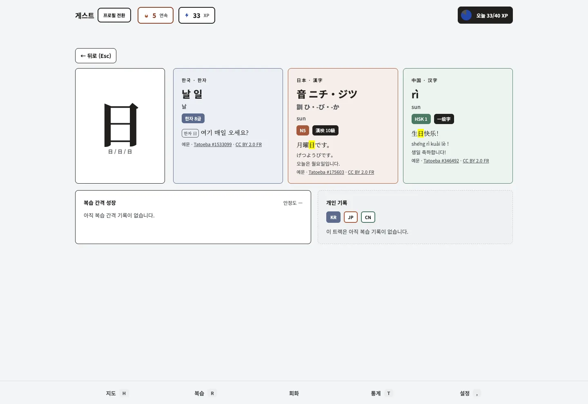</td>
    <td>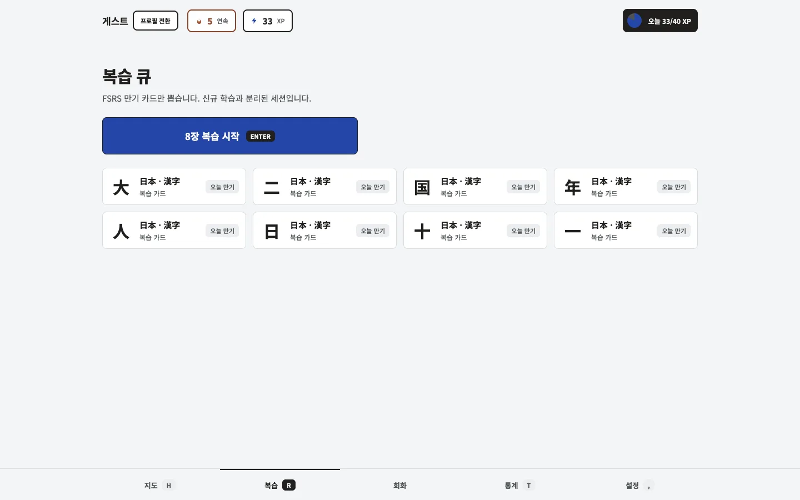</td>
  </tr>
  <tr>
    <td>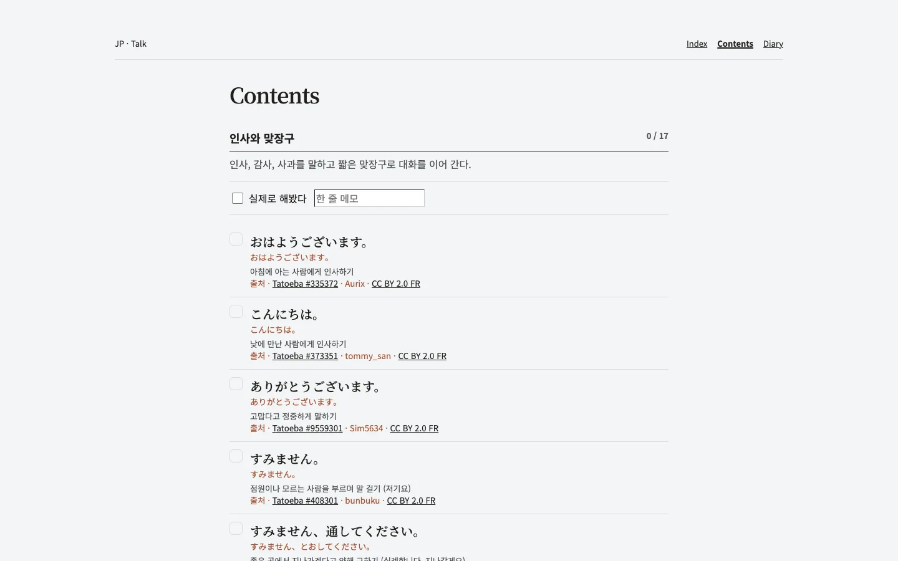</td>
    <td>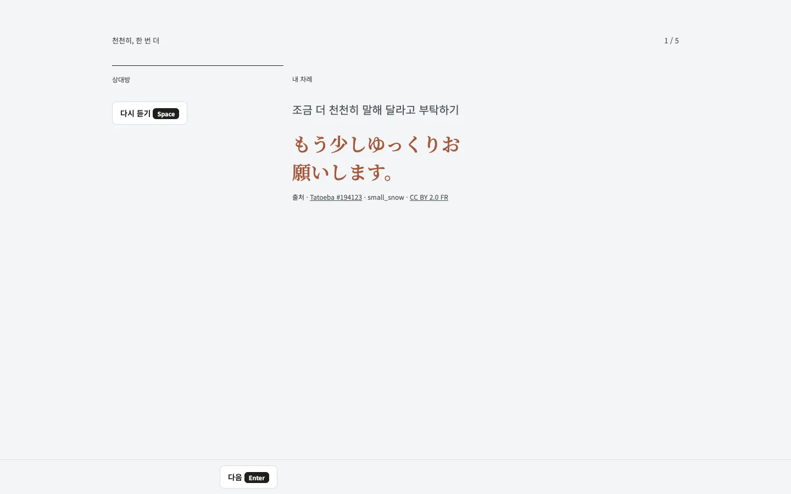</td>
  </tr>
  <tr>
    <td>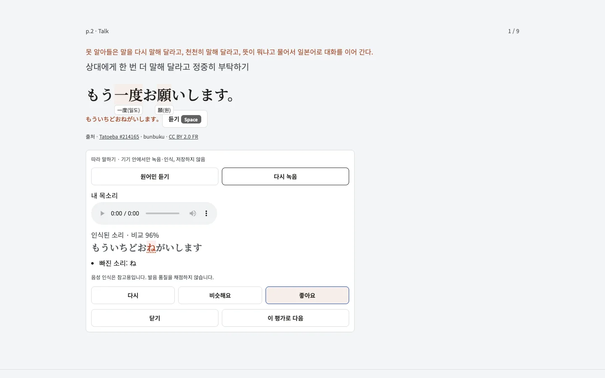</td>
    <td>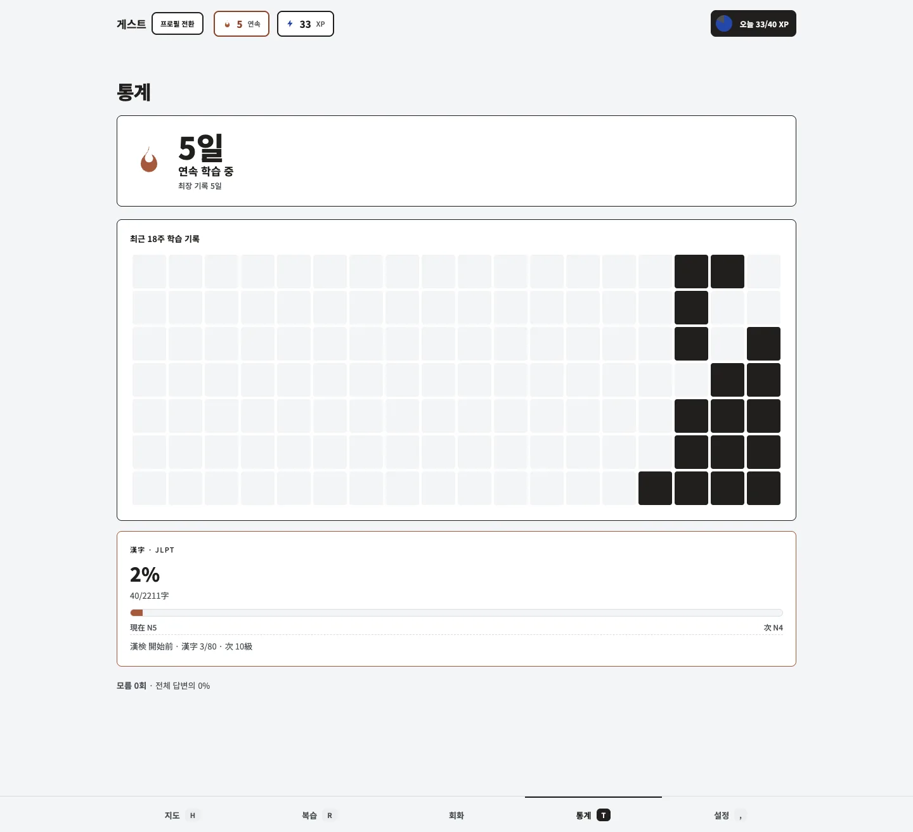</td>
  </tr>
  <tr>
    <td>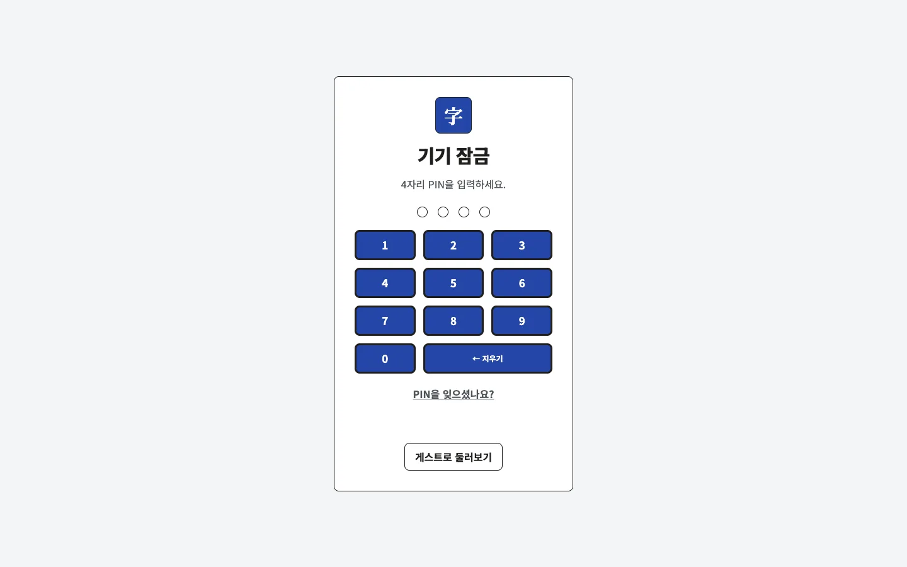</td>
    <td></td>
  </tr>
</table>

Mobile (390 px wide):

<table>
  <tr>
    <td>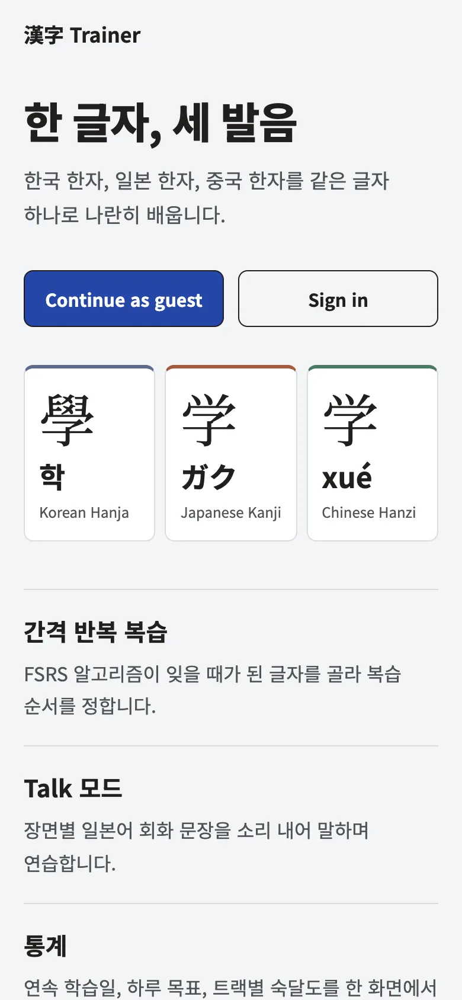</td>
    <td>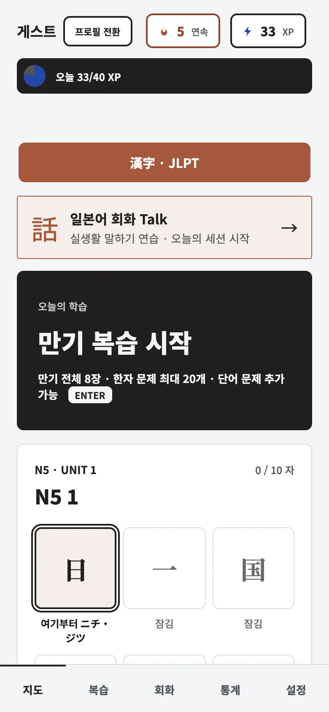</td>
    <td>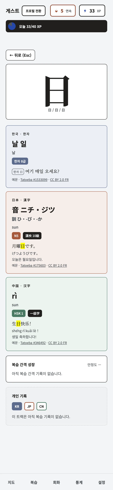</td>
    <td>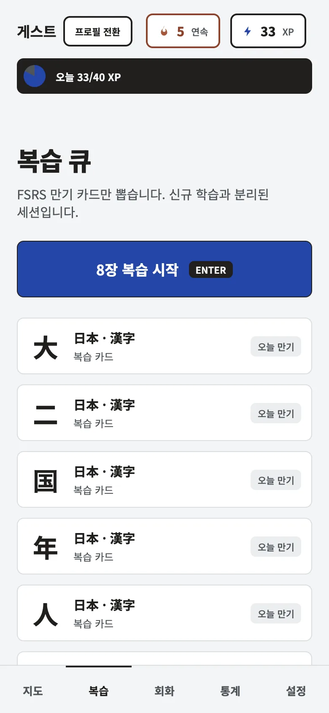</td>
  </tr>
  <tr>
    <td>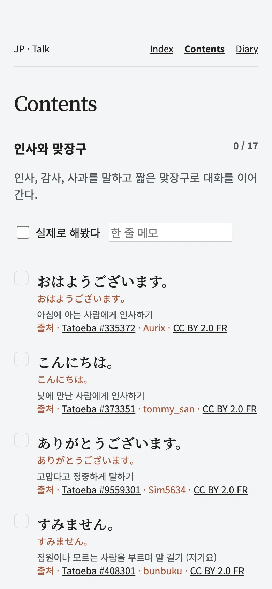</td>
    <td>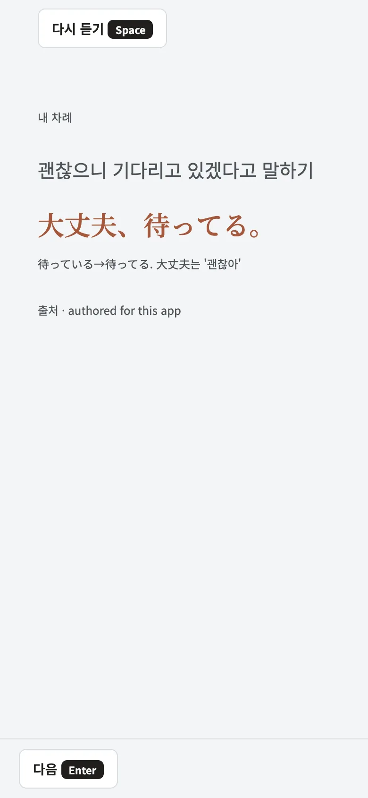</td>
    <td>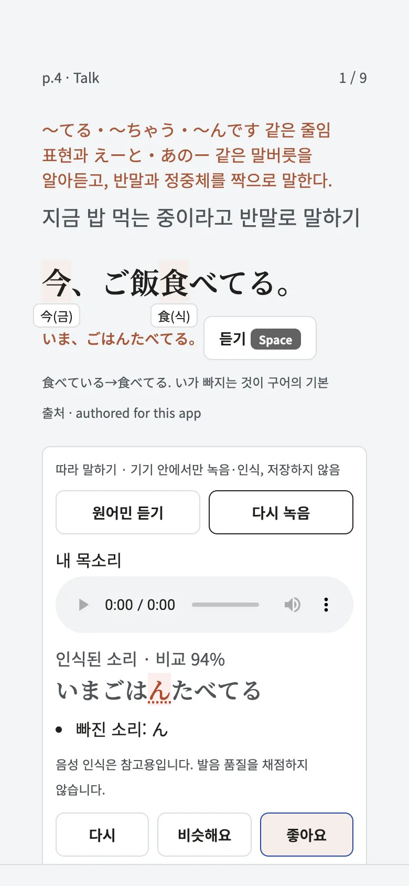</td>
    <td>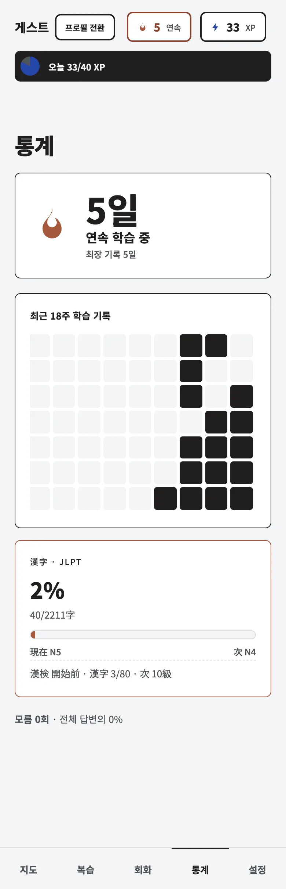</td>
  </tr>
  <tr>
    <td>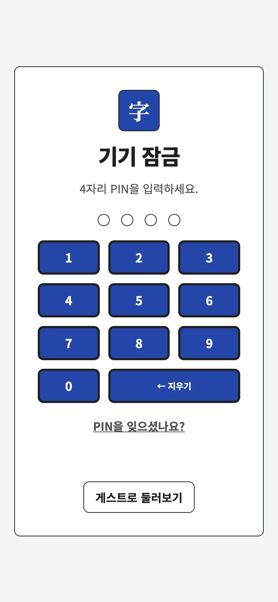</td>
  </tr>
</table>

## Status and limits

- About 160 authored Talk lines (listed in `data/conversation/audio-todo.json`)
  have no generated audio yet; the card falls back to the browser's
  `speechSynthesis` voice, which varies by device and can be absent.
- Speech feedback compares the recognizer's transcript with the target line. It
  is a text diff, not a pronunciation or pitch-accent score.
- Guest accounts are per-visitor sandboxes: a fresh profile per browser, kept
  7 days, never shared or merged.
- The mobile wrappers build in CI but are not published to any store.
- Open items are tracked in [GitHub issues](https://github.com/euisuh/hanja-trainer/issues).

## Tech stack

- Cloudflare Workers (API and static assets), D1 (SQLite) and R2 (cached audio)
- React + Vite single-page app, TypeScript throughout
- Capacitor wrappers for iOS and Android (`android/`, `ios/`)
- FSRS for review scheduling
- Vitest and Playwright for tests

## Architecture

The React SPA and Worker API share one origin. D1 holds content and learner
state; R2 serves generated audio. Capacitor wraps the same SPA, and an offline
write queue retries answers with their original timestamps. See
[architecture](docs/architecture.md) for diagrams, tables and request flow.

## Quick start

```sh
npm install
npx wrangler d1 migrations apply hanja --local
npm run seed:local
npm run dev
```

## Design decisions

- [FSRS scheduling](docs/decisions.md#fsrs-scheduling) keeps due state on the server.
- [One origin](docs/decisions.md#one-origin-for-spa-and-api) serves the SPA and API.
- [Corpus-first Talk content](docs/decisions.md#corpus-first-talk-content) caps authored lines.
- [Device-side speech feedback](docs/decisions.md#device-side-speech-feedback) keeps recordings out of D1.
- [Guest sandboxes](docs/decisions.md#per-visitor-guest-sandboxes) separate visitor progress.
- [One Quiet theme](docs/decisions.md#one-quiet-theme) shares design tokens across screens.
- [Offline writes](docs/decisions.md#offline-write-queue) preserve answer times during retries.

## Documentation

- [Documentation index](docs/README.md)
- [Components, schema and request flow](docs/architecture.md)
- [Design decisions](docs/decisions.md)
- [Local setup, checks, tests and e2e](docs/development.md)
- [Deploy, migrations, PINs and backups](docs/deployment.md)
- [Capacitor setup and builds](docs/mobile.md)
- [Mobile roadmap](docs/mobile-roadmap.md)
- [Internal store distribution](docs/store-release.md)
- [Talk content and practice rules](docs/talk-mode.md)
- [Learning design evidence and limits](docs/learning-evidence.md)
- [Speaking practice scope](docs/speaking-practice-scope.md)

[Contributing](CONTRIBUTING.md) · [MIT license](LICENSE) · [Data sources](data/SOURCES.md) · [Notices](NOTICE)
