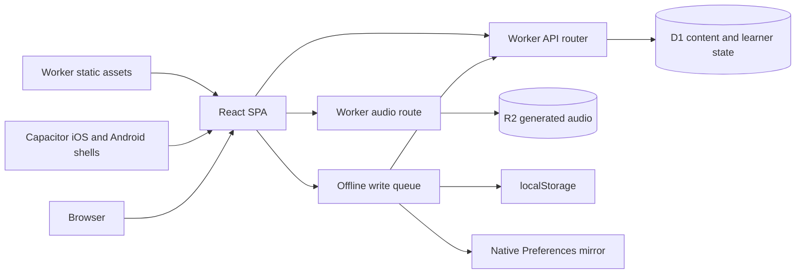
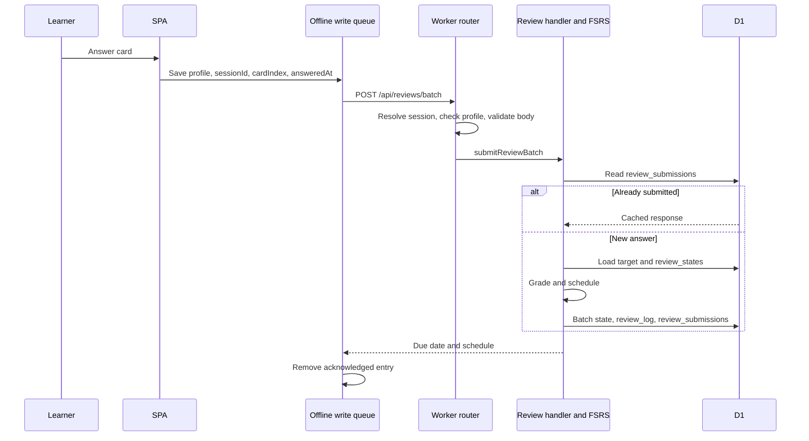

# Architecture

[Documentation index](README.md)

## Components

[Worker entrypoint](../worker/index.ts) serves `/api/audio/*` before the API
router, dispatches other `/api/*` requests to [the router](../worker/api/router.ts),
and delegates remaining paths to the `ASSETS` binding. [Wrangler config](../wrangler.jsonc)
binds `DB` to D1 database `hanja`, `AUDIO` to R2 bucket `hanja-audio`, and serves
`dist/client` with SPA fallback. The browser SPA and API use one origin.
Capacitor bundles that SPA and calls the deployed API using bearer tokens.

`src/routes.tsx` maps screens; `src/features/` holds practice flows and reusable
UI. `src/lib/apiClient.ts` handles API calls; `src/platform/` holds native seams.
The router resolves the profile before dispatching learning routes, validates
requests and returns JSON errors. Its API modules cover cards and curriculum,
reviews, placement, unit tests, sessions, settings, profiles, stats, guest
sessions, and conversation content/attempts/stats. `worker/db/` loads characters,
words and review state with prepared SQL.

## One review answer

For an ordinary character review, `useAnswerSubmit` enqueues the answer before
sending it. The shared outbox scopes entries to a profile and retains failures.
[Review submission](../worker/api/reviews.ts) deduplicates by profile, session and
card index. It derives a grade from correctness/skips, then calls
[FSRS](../shared/fsrs.ts). The state, log and cached response are written in one
D1 batch. Placement logs answers without updating scheduled review state; word
answers update the two member characters.

[Queue building](../shared/buildQueue.ts) selects due cards, mixes due and fresh
cards for lessons, constructs distractors and inserts eligible word/comparison
cards. It runs on the Worker via `worker/api/cards.ts`, not in the browser.
[Offline timing rules](deployment.md#offline-review-times) preserve event times
without moving current FSRS state backward. The queue does not download cards
for offline study. Native Preferences mirroring is asynchronous; see
[mobile storage limits](mobile.md).

## D1 tables

Names below are the final table names from [migrations](../migrations/).
Rebuild migrations temporarily use names ending in `_new`; those are not extra
application tables. Learner tables use `profile_id` to separate profiles.

| Tables | Role and selected columns |
| --- | --- |
| `characters`, `character_tracks` | Character identity (`id`, `key`) and per-track readings (`character_id`, `track`, `glyph`). |
| `example_sentences` | Source sentences, `text`, `reading`, `source`, `target_index`. |
| `curriculum_units`, `curriculum_unit_members` | Ordered units and their `unit_id`, `character_id` membership. |
| `words`, `word_members` | Compounds and ordered character membership (`word_id`, `character_id`, `position`). |
| `profile` | Settings, `pin_hash`, `pin_salt`, `pin_secret`, `is_demo`, `demo_client`, `demo_writes`, `demo_active_at`. |
| `review_states` | Per-character/track FSRS state: `stability`, `difficulty`, `due`, `last_review`. |
| `review_log`, `review_submissions` | Answer history (`answered_at`) and replay responses (`session_id`, `card_index`, `response_json`). |
| `sessions`, `placement_results` | Session summaries (`client_session_id`) and placement history. |
| `curriculum_unit_completion_members`, `curriculum_unit_test_attempts` | Test-out credit and issued test attempts. |
| `conv_units`, `conv_chunks`, `conv_unit_chunks` | Talk units, reusable lines (`ja`, `kana`, `ko_cue`, `source_kind`, `source_ref`, `audio_key`, `retired_at`) and membership. |
| `conv_scenes`, `conv_scene_turns` | Role-play scenes and turns (`speaker`, `chunk_ids`, `variants`). |
| `conv_chunk_states`, `conv_attempts` | Line FSRS state and idempotent attempts (`client_attempt_id`, `grade`, `latency_ms`, `loop`, `input`, `hints`, `replays`). |
| `conv_templates`, `conv_template_states` | Slot drills (`ja_template`, `slots`, `pattern_chunk_id`) and per-profile scheduling. |
| `conv_checkins` | Practice diary (`unit_id`, `at`, `note`). |

Migrations are append-only after reaching shared environments. See
[migration rollout](deployment.md#d1-migrations). Checked-in datasets are loaded
by the idempotent seed script; learner history is separate from source content.

## Auth and guest model

[PIN implementation](../worker/auth/pin.ts) hashes four-digit PINs using salted
PBKDF2-SHA-256 (100,000 iterations). It signs session tokens using HMAC-SHA-256
and each profile's `pin_secret`. Browser sessions use `hanja_session` with
`HttpOnly; Secure; SameSite=Strict; Path=/`; real-profile sessions have a rolling
two-hour token window and no persistent cookie age. PIN changes rotate secrets.
A lone PIN-less profile is public by design, not an Internet account system.
Admin recovery codes and profile lockouts are described in
[optional profile PIN](deployment.md#optional-profile-pin).

A trusted browser may list real profiles through a real session or a signed
`hanja_device` cookie from PIN unlock/recovery (400 days). Otherwise only the
redacted admin entry is exposed, except for a lone PIN-less profile or explicit
`ALLOW_PROFILE_LIST=true`. Selection of hidden PIN-less profiles needs the same
trust. Native origins `capacitor://localhost` and `https://localhost` use bearer
transport only. Invalid bearer attempts never fall back to cookies. Browser
cross-site writes are rejected; these native origins receive CORS headers.

[Guest creation](../worker/api/demo.ts) and its imported expiry constants in
[PIN auth](../worker/auth/pin.ts) define these limits:

| Limit | Value |
| --- | --- |
| Per client IP creation limit | 5 creates per hour, keyed by hashed `CF-Connecting-IP` |
| Live guest profile cap | 200 |
| Lifetime write quota | 2,000 per guest profile |
| Sliding inactivity expiry | 7 days |
| Absolute lifetime cap | 30 days after creation |

The creation limit counts existing guest rows created in the previous hour.
The router spends one quota unit per authenticated write request, including a
batch request. Each visitor gets a separate Japanese-only, onboarded `profile`
with `is_demo = 1`, no PIN and no merge path. A valid returning session resumes
its sandbox. Server-clock `demo_active_at` is checked and refreshed atomically;
expired profiles are rejected, then deleted on the next guest creation.
Guests cannot manage profiles or credentials and do not count toward the
five-real-profile limit. Full privacy/setup details:
[development](development.md#profile-list-privacy-and-guest-accounts).

## Talk content pipeline

1. [data/conversation](../data/conversation/) contains unit JSON: lines, Korean
   cues, provenance, scenes, variants and slot templates. Corpus lines retain
   source references; authored lines require review metadata.
2. [validate-conversation.ts](../scripts/validate-conversation.ts), run with
   `npm run validate:conversation`, checks structure, references, cues and
   authored caps. `npm run verify:conversation` additionally verifies remote
   source text; ordinary validation is not a remote provenance check.
3. [seed.ts](../scripts/seed.ts) parses with the same validator, then upserts
   content into D1. `npm run seed:local` targets local D1;
   `npm run seed:remote` writes remote D1. Chunk identity is shared across units
   via `conv_unit_chunks`; retired lines can retain attempt history.
4. [conversation.ts](../worker/api/conversation.ts) reads current content and
   profile state, selects due/new lines and a scene (unseen first, otherwise
   least recently practiced), then calls
   [composeTalkSession](../shared/talkSession.ts) for the session response.
5. `src/features/conversation/` renders listening, shadowing, slot drills and
   scenes; attempts go through `worker/api/conversationAttempts.ts`. Generated
   audio uses [generate-audio.ts](../scripts/generate-audio.ts) and R2, with
   browser speech synthesis fallback where clips are missing.

Recording blobs and transcripts stay in frontend memory and are not sent to
this app's Worker or D1. Browser-provided recognition is optional; the code does
not force local-only processing by the browser's recognition provider. Only
practice results/metrics are submitted. See [speech decision](decisions.md#device-side-speech-feedback).

## Directory map

| Path | Contents |
| --- | --- |
| [src/](../src/) | SPA entry, routes, screens, shell, feature UI, design tokens and platform adapters. |
| [worker/](../worker/) | Entrypoint, API handlers, PIN/session auth, DB queries and audio route. |
| [shared/](../shared/) | Types/contracts, FSRS wrapper, queue construction and Talk composer. |
| [migrations/](../migrations/) | Ordered D1 schema migrations. |
| [data/](../data/) | Characters, sentences, words, conversation and source/license records. |
| [scripts/](../scripts/) | Dataset preparation, validation, seeding, audio generation, checks and e2e setup. |
| [android/](../android/), [ios/](../ios/) | Capacitor native projects. |
| [docs/](./) | Product, development and operations documentation. |
| [design/](../design/), [design-prompt.md](../design-prompt.md) | Wireframe reference and product spec. |
| [wrangler.jsonc](../wrangler.jsonc) | Worker entry, static assets, domain, D1 and R2 bindings. |
