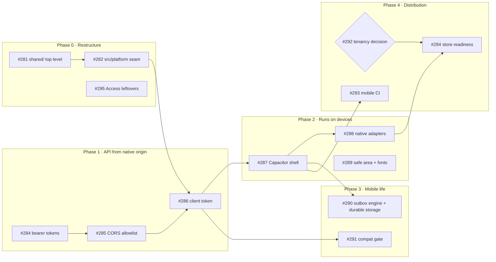

# Android and iOS roadmap

Tracking epic: [#296](https://github.com/euisuh/hanja-trainer/issues/296).

## Decision: Capacitor around the existing SPA

The Worker already owns everything that is hard to port: FSRS scheduling
(`worker/api/reviews.ts`), queue and distractor building (`worker/api/cards.ts`
→ `shared/buildQueue.ts`), and idempotent review writes keyed by
`(profile, session, cardIndex)`. The client renders what the API returns.

| Option | Reuse | Cost | Verdict |
|---|---|---|---|
| Capacitor (WebView shell) | ~100% of `src/`, all CSS, all e2e | auth/CORS work, a few native adapters | **chosen** |
| React Native / Expo | `shared/`, `src/lib/apiClient.ts` | rewrite every screen and ~2,000 lines of CSS | only if WebView performance proves insufficient |
| Swift + Kotlin | API contract only | two full apps | no |

Revisit only if a real device shows the session screen dropping frames.

## Roadmap

## Why each phase exists

### Phase 0 — Restructure
- `shared/` is the contract consumed by the Worker, the web client, and the
  native shell. It must stay free of DOM, React, and Worker APIs.
- `src/platform/` is the only place allowed to touch platform capabilities
  (API origin, haptics, storage, lifecycle, later `@capacitor/*`). Screens and
  features import from it; they never branch on platform themselves.
- `VITE_API_ORIGIN` unset = web build, same-origin, unchanged behavior.

### Phase 1 — Authentication from a native origin
The session is an `HttpOnly; SameSite=Strict` cookie. A WebView served from
`capacitor://localhost` / `https://localhost` never sends it to
`hanja.uiseoya.com`, and the Worker rejects cross-site writes and emits no CORS
headers. The signed token inside the cookie is self-contained, so the fix is to
also accept it as `Authorization: Bearer`, allow exactly the two Capacitor
origins, and refuse cookies from them.

### Phase 2 — Runs on devices
Add the Capacitor projects, then replace web behaviors that WebViews lack:
`navigator.vibrate` (absent on iOS), token persistence, flushing outboxes on
app resume (no `online` event after suspension), Android back button inside a
session, microphone permission strings. Safe-area insets and self-hosted fonts
also help the mobile web today.

### Phase 3 — Survives real mobile life
- iOS can purge WebView `localStorage`; queued answers must be mirrored to
  native storage. Do the duplicated outbox extraction first so the fix lands
  once.
- Installed builds outlive Worker deploys; a public compatibility endpoint
  lets the Worker tell stale apps to update instead of failing silently.

### Phase 4 — Distribution
The deployment is one household: profile names are public and PIN-less
profiles are selectable by anyone. That is fine for private distribution
(TestFlight internal, Play internal track). A public store listing requires
real accounts first — an owner decision tracked in #292.

## Rules while this is in progress
- Keep scheduling and queue building on the Worker. Never duplicate them in
  the client for speed; use optimistic labels instead.
- New API routes keep returning JSON with `{ error: { code, message } }`.
- Additive API changes only; a breaking change bumps `API_COMPAT_VERSION` (#291).
- `@capacitor/*` imports live only in `src/platform/` and `src/main.tsx`.
